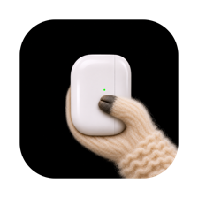

<p align="center">
  
</p>

<h1 align="center">AirClicker</h1>

<p align="center">
  <strong>閉じたAirPodsケースを、プレゼンのクリッカーに。</strong><br>
  1回タップで次のスライド、2回タップで前のスライド。
</p>

<p align="center">
  <a href="README.md">English</a> · 日本語
</p>

<p align="center">
  <a href="https://github.com/nijirow12/airclicker/releases/latest"><strong>アプリをダウンロード</strong></a>
</p>

## なぜ作ったか

専用のクリッカーは、年に数回の発表のために、買い足して、充電して、持ち歩く機器です。スマホでスライドを送ると、手元を見ながら話すことになり、聴衆には「カンペを読んでいる人」に見えてしまいます。

AirPodsは、すでに持っています。そのケースには、動きを測るセンサーが入っています。AirClickerは、フタを閉じたままセンサーの値を読み、ケースのタップを矢印キーに変えます。視線は、聴衆に向けたままにできます。

## できること

- **1回タップで次のスライド、素早く2回タップで前のスライド。** カーソルは動かさず、画面の調整も要りません。
- **フタを閉じたまま使えます。** フタを開けて接続し、閉じて、ケースを縦に持ち、表面をタップします。
- **自分の手に合わせられます。** リアルタイムのタップテスト、5段階の感度、ダブルタップの間隔の調整、「Teach Tap」を用意しています。
- **Motion Lab。** 判定の元になる加速度と回転の値を表示します。タップが受け入れられた理由、無視された理由を見られます。
- **すべてMacの中で完結します。** データは外に送りません。

このリポジトリには、アプリのダウンロードと、その説明があります。ソースコードは公開していません。

## 使う前に

AirClickerは非公式のツールです。Appleが公開していないBluetoothの仕組みを使ってAirPodsと通信します。Appleとは関係がありません。次の表を、先に読んでください。

| 影響 | 内容 |
|---|---|
| **ケースのデータ** | セッションを終えると、ケースに保存されている診断データを使い切ります。 |
| **AirPodsの設定** | セッションが変えたAirPodsの接続設定の一部は、そのまま残ります。この変更や、ケースのデータへの変更が、Bluetoothの接続をリセットした後も続くかは、まだ分かっていません。 |
| **音声** | 接続のたびに、AirPodsのBluetooth接続が一瞬切れて、音声が止まります。通話中は接続しないでください。 |
| **マイク** | セッション中、アプリは、すべてのAirPodsでMacの音声とマイクを使わないようにします。セッションの終了時に元へ戻します。強制終了した場合は、次にアプリを開いたとき、AirPodsがまだ接続されていれば元へ戻します。 |
| **無音の再生** | セッション中、アプリはAirPodsに無音を流して、音声の接続を保ちます。音は聞こえません。 |
| **macOSの更新** | アプリは、公開されていないBluetoothのクラスを使います。macOSの更新で、そのクラスがなくなると、接続できなくなることがあります。 |

## 動作環境

| 項目 | 状態 |
|---|---|
| AirPods Pro 3、macOS 26、Apple Silicon | 1台のMacと1組のAirPodsで確認 |
| AirPods Pro 2 | 認識するが、未確認 |
| Macとペアリング済みのAirPods | 必須 |

通常の接続と切断は、そのMacとAirPodsで何度も動かしています。次のケースは、意図して試していません。強制終了、スリープと復帰、Bluetoothの切断、セッション中とセッション後の通話や音声です。

## インストール

1. [最新のリリース](https://github.com/nijirow12/airclicker/releases/latest)から `AirClicker-0.2-macos-arm64.zip` をダウンロードして、展開します。
2. `AirClicker.app` を、アプリケーションフォルダに移します。
3. このアプリは、手元で使うための署名だけで、Appleの公証は受けていません。そのため、初回の起動はmacOSにブロックされます。ダウンロードの印を外してから、開いてください。

```sh
xattr -dr com.apple.quarantine /Applications/AirClicker.app
open /Applications/AirClicker.app
```

あとで「アクセシビリティ」の一覧にAirClickerが出ないときは、リセットして、アプリを開き直します。

```sh
tccutil reset Accessibility local.airclicker
```

## セットアップ

初めてアプリを開くと、セットアップは3ステップです。

1. **許可:** AirClickerを「アクセシビリティ」の一覧に追加します。スライドへ矢印キーを送るために必要です。
2. **接続:** フタを開け、閉じて、ケースを少し置いてから、縦に持ちます。
3. **タップ:** ケースの表面を3回タップして、あなたのタップの感触を覚えさせます。

## 使い方

どのアプリからでも、**fn ⌃** を押すと接続します。もう一度押すと、一時停止と再開を切り替えます。ショートカットは、設定で変えられます。

ケースを縦に持って接続すると、タップの待ち受けが自動で始まります。

| 操作 | 結果 |
|---|---|
| 1回タップ | 次のスライド（→） |
| 素早く2回タップ | 前のスライド（←） |
| **fn ⌃** | どのアプリからでも、待ち受けの一時停止と再開 |
| ウィンドウの一時停止ボタン | 接続は切らずに、一時停止 |
| Disconnect | 自分の意思で、接続を終了 |

1回のタップは、ダブルタップの間隔（標準は0.4秒、0.25〜0.55秒で調整可能）が過ぎてから、→を送ります。間隔の中に2回目のタップがあると、→を取り消して、←を送ります。そのため、素早く3回タップすると、←のあとに→を送ります。

先に、プレゼンのウィンドウをクリックして、矢印キーがそこに届くようにしてください。

## 調整する

**設定**（⌘,）で、手とケースに合わせて調整します。

| 設定 | 内容 |
|---|---|
| **Sensitivity** | **Firm** から **Light** までの5段階。Lightは、弱くて正確でないタップも拾い、持ち直しも拾いやすくなります。Firmは、はっきりしたタップを求めます。 |
| **Test taps** | **Start Test** を押して、ケースをタップします。最後のタップが **Tap heard** として表示されます。受け入れられなかった場合は、理由（*Too soft*、*Off axis*、*Hand moving*、*Case turning*、*Too soon after a tap*）が出ます。テストのタップは、矢印キーを送りません。 |
| **Double-tap window** | 短いと、次へが早く進みます。長いと、2回タップの「前へ」が楽になります。 |
| **Tap sound** | タップでスライドが変わるとき、このMacで鳴るクリック音。 |
| **Teach Tap…** | タップがケースを押す向きを覚えさせます。持ち方を変えたら、もう一度行います。 |
| **AirPods** と **Shortcut** | 使うAirPodsの組と、接続・一時停止・再開のグローバルキー。 |

**Test taps** を開いたまま調整してください。タップのたびに表示が更新されるので、軽いタップは数えて、持ち直しは数えない、ちょうどよい点を見つけられます。

### Motion Lab

**Settings ▸ Motion Dashboard…** を開くと、タップの元になる数値を見られます。直近6秒の加速度と回転のスコープ、リアルタイムのX/Y/Z、判定が使う各テスト（jolt、alignment、rotation、stillness）の合否です。**Record** は、すべての生のサンプルを、`~/Library/Application Support/AirClicker/MotionLab/` にCSVで保存します。

## しくみ

動きは、閉じたケースの中のセンサーから、次の順で、スライドになります。構造の図は、[英語版](README.md#how-it-works)にあります。

1. **接続:** 復元用のヘルパーが、AirPodsの通常のBluetooth接続を確実に立ち上げます。動きのチャンネルは、接続の直後にしか応答しないため、その後、動き用のヘルパーが一度、つなぎ直します。
2. **ストリーム:** 動き用のヘルパーがセンサーを開始し、閉じたケースが眠らないよう、少しずつ要求を送ります。動きのデータは、アプリに渡します。
3. **生存確認:** アプリは、1秒ごとに生存確認を送ります。アプリが止まると、ヘルパーはセンサーを止めて、持っているものを手放します。
4. **タップの判定:** アプリが、指がケースの前面を押す向きの、急な動きを探します。加速度と回転から判定するので、持ち直し、回転、ぶつかりは除かれます。
5. **スライド:** アプリが、ダブルタップの間隔を待ってから、→か←を送ります。

## 既知の制限

**フタを閉じてから、約30分でセッションが終わります。** アプリが決めた制限ではありません。その時点で動きが止まり、フタを開けるまで、AirPodsには届かなくなります。続けるには、フタを開けて、閉じ直します。測定したセッションは、フタを閉じてから、約1,805秒で終わっています。

原因は、イヤホンのファームウェアにある30分のタイマーだと見ています。確認したAirPods Pro 3（H2、バージョン9A348）のファームウェアのイメージを読んで見つけました。これは、ファームウェアの読み取りと、測定した時間からの推定です。実機での確認は、まだ取れていません。

## トラブルシューティング

| 問題 | 対処 |
|---|---|
| 「壊れている」「開けません」とmacOSに言われる | `xattr -dr com.apple.quarantine /Applications/AirClicker.app` を実行して、もう一度開きます。 |
| アプリが接続しない | iPhoneのBluetoothをオフにします。iPhoneが、AirPodsをつかんでいることがあります。 |
| 「Connecting」が終わらない | アプリが閉じるよう案内するまで、フタを開けたままにします。 |
| スライドが変わらない | 先に、プレゼンのウィンドウをクリックして、矢印キーがそこに届くようにします。 |
| タップを見逃す、または二重に数える | Settings > Start Test を開いて、ケースをタップします。*Too soft* と出るなら、Sensitivityを上げます。持ち直しで *Tap heard* と出るなら、下げます。そのあと、Teach Tapを使います。 |
| タップは検出されるが、向きが逆 | Settings > Teach Tap を開いて、発表中の持ち方で、前面を3回タップします。 |
| セッション中に動きが止まる | OBSやブラウザの通話など、AirPodsをマイクとして使う他のアプリがないか確認します。 |
| 接続の直後に、動きがぎこちない | 約20秒は、正常です。 |
| 「Set it down」に時間がかかる | 硬くて平らな面を使い、ケースには触れないでください。 |
| タップ音が鳴らない | Settings > Tap sound をオンにします。 |

## Macに保存されるデータ

アプリは、データを `~/Library/Application Support/AirClicker/` に保存します。外には送りません。

| ファイル | 内容 |
|---|---|
| `closed-case-target.txt` | 使うAirPods |
| `closed-case-grip.json` | 保存したセンサーの持ち方 |
| `closed-case-sensor-calibration.json` | 保存したセンサーのずれ（1週間保持） |
| `ClickerSessions/` | 新しい10セッション分のログ |
| `MotionLab/` | Motion LabのRecordボタンで作った記録 |

セッション中、アプリの環境設定には、動かした音声デバイスも保存されます。保存される名前には、AirPodsのBluetoothアドレスが含まれます。

## アンインストール

AirClickerを終了し、`AirClicker.app` を削除してから、次を実行します。

```sh
rm -rf ~/Library/Application\ Support/AirClicker
defaults delete local.airclicker
tccutil reset Accessibility local.airclicker
tccutil reset BluetoothAlways local.airclicker
```

## クレジットとライセンス

[AirPointer](https://github.com/musubipapi/airpointer)（musubipapi、MIT License）をもとに作っています。[LICENSE](LICENSE) を見てください。

MIT Licenseは、アプリの中の画像と音には及びません。ケースの画像の元になるAirPods Pro 3のARモデルは、Appleのものです。2つのタップ音には、cuelume（MIT license、© 2026 Daniel Belyi）の一部を使っています。

AirPodsとmacOSは、Apple Inc.の商標です。AirClickerは、Appleとは関係がなく、Appleの承認を受けたものでもありません。
