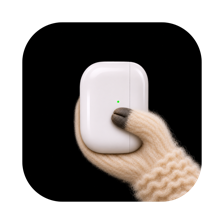
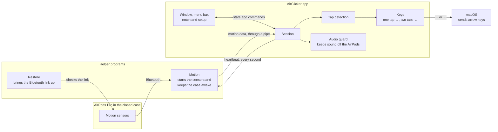

<p align="center">
  
</p>

<h1 align="center">AirClicker</h1>

<p align="center">
  <strong>Turn your closed AirPods case into a presentation clicker.</strong><br>
  Tap once for the next slide. Tap twice for the previous one.
</p>

<p align="center">
  English · <a href="README.ja.md">日本語</a>
</p>

<p align="center">
  <a href="https://github.com/nijirow12/airclicker/releases/latest"><strong>Download the app</strong></a>
</p>

<p align="center">
  
  
  
</p>

## Why

A dedicated clicker is one more thing to buy, charge and carry for a talk you give a few times a year. Sending slides from your phone is free, but looking down at it makes you look like you are reading notes.

You already own AirPods, and the case holds motion sensors. AirClicker reads them while the lid is closed, so a tap on the case becomes an arrow key and you keep your eyes on the room.

## What you get

- **One tap → next slide, two quick taps → previous slide.** Nothing moves the cursor and there is no screen calibration.
- **Works with the lid closed.** Open the lid to connect, close it, hold the case upright and tap its front.
- **Tunable to your hand.** A live tap test, five sensitivity steps, an adjustable double-tap window and a "Teach Tap" step.
- **A Motion Lab** that shows the raw acceleration and rotation behind every decision, so you can see why a tap was accepted or ignored.
- **Local only.** Nothing leaves your Mac.

This repository holds the app download and its documentation. The source code is not published.

## Before you use it

AirClicker is unofficial. It talks to the AirPods through Bluetooth interfaces that Apple does not document, and it is not affiliated with Apple. Read this table first.

| Effect | What happens |
|---|---|
| **Case data** | Ending a session uses up the diagnostic data stored on the case. |
| **AirPods settings** | Some AirPods connection settings stay as the session set them. We do not know yet if this change, or the case data change, lasts after the Bluetooth link resets. |
| **Audio** | Each connection drops the AirPods' Bluetooth link for a moment, and their audio stops. Do not connect during a call. |
| **Microphone** | During a session, the app keeps Mac sound and the microphone off all AirPods. It restores them when the session ends. After a force quit, it restores them when you next open the app, if the AirPods are still connected. |
| **Silent audio** | During a session, the app plays silence to the AirPods to keep their audio link active. You do not hear it. |
| **macOS updates** | The app uses private Bluetooth classes. A macOS update can remove them and stop the app from connecting. |

## Requirements

| Item | Status |
|---|---|
| AirPods Pro 3, macOS 26, Apple Silicon | Tested on one Mac with one pair |
| AirPods Pro 2 | Recognized, not tested |
| AirPods paired with your Mac | Required |

Normal connect and disconnect have run many times on that Mac and pair. These cases have not been tested on purpose: force quit, sleep and wake, Bluetooth loss, and calls or audio during and after a session.

## Install

1. Download `AirClicker-0.2-macos-arm64.zip` from the [latest release](https://github.com/nijirow12/airclicker/releases/latest) and unzip it.
2. Move `AirClicker.app` to your Applications folder.
3. The app is signed for local use only, not notarized by Apple, so macOS blocks the first launch. Remove the download flag, then open it:

```sh
xattr -dr com.apple.quarantine /Applications/AirClicker.app
open /Applications/AirClicker.app
```

If AirClicker does not appear in the Accessibility list later, reset it and open the app again:

```sh
tccutil reset Accessibility local.airclicker
```

## Set it up

The first time you open the app, setup has three steps.

1. **Allow:** Drag AirClicker into the Accessibility list. It needs this to send arrow keys to your slides.
2. **Connect:** Open the lid, close the lid, set the case down for a moment, and turn it upright.
3. **Tap:** Tap the front of the case three times so it learns how your taps feel.

## Use it

Press **fn ⌃** in any app to connect. Press it again to pause or resume. You can change the shortcut in Settings.

Once the case is upright and connected, tap listening starts by itself:

| Action | Result |
|---|---|
| Tap once | Next slide (→) |
| Tap twice quickly | Previous slide (←) |
| **fn ⌃** | Pause or resume tap listening from any app |
| Pause button in the window | Pause without ending the connection |
| Disconnect | End the connection on purpose |

A single tap sends → after the double-tap window closes (0.4 s by default, adjustable from 0.25 to 0.55 s). A second tap inside the window sends ← instead and cancels the →. Three quick taps therefore send ← and then →.

Click the presentation window first, so the arrow keys go to it.

## Tune it

Open **Settings** (⌘,) to make taps fit your hand and your case.

| Setting | What it does |
|---|---|
| **Sensitivity** | Five steps from **Firm** to **Light**. Light reaches softer, less exact taps and can pick up more handling. Firm asks for a deliberate tap. |
| **Test taps** | Press **Start Test**, then tap the case. The pad shows the last tap as **Tap heard**, or says why it was rejected: *Too soft*, *Off axis*, *Hand moving*, *Case turning*, *Too soon after a tap*. Test taps never send arrow keys. |
| **Double-tap window** | Shorter sends Next sooner. Longer makes a two-tap Previous easier. |
| **Tap sound** | The click on this Mac when a tap changes the slide. |
| **Teach Tap…** | Learn the direction your taps push the case. Do it again after you change how you hold it. |
| **AirPods** and **Shortcut** | Which pair to use, and the global key that connects, pauses and resumes. |

Tune sensitivity with **Test taps** open. Every tap updates the pad, so you can find the point where light taps count and handling does not.

### Motion Lab

Open **Settings ▸ Motion Dashboard…** for the numbers behind a tap: a scope of the last six seconds of acceleration and rotation, live X/Y/Z values, and a pass or fail for each test the detector applies (jolt, alignment, rotation, stillness). **Record** writes every raw sample to `~/Library/Application Support/AirClicker/MotionLab/` as CSV.

## How it works



1. **Connect:** The restore helper makes sure the AirPods' ordinary Bluetooth link is up. The motion helper then reconnects them once, because the motion channel only answers just after a connection.
2. **Stream:** The motion helper starts the sensors and sends paced requests to keep the closed case awake. It sends the motion data to the app.
3. **Keep alive:** The app sends a heartbeat every second. If the app stops, the helper stops the sensors and releases what it holds.
4. **Tap:** The app looks for a sudden movement in the direction a finger pushes the front of the case. Taps are judged from acceleration and rotation, so handling, turning and bumps are rejected.
5. **Present:** The app waits for the double-tap window, then sends → or ←.

## Known limitations

**Sessions end about 30 minutes after the lid closes.** The app does not set this limit. At that point motion stops, and the AirPods stay unreachable until you open the lid. To continue, open and close the lid. Measured sessions ended about 1,805 seconds after the lid closed.

The likely cause is a 30-minute timer in the earbud firmware, found by reading the firmware image of the tested AirPods Pro 3 (H2, version 9A348). That comes from reading the firmware and from the timings. No live capture has confirmed it yet.

## Troubleshooting

| Problem | What to do |
|---|---|
| macOS says the app is damaged or cannot be opened | Run `xattr -dr com.apple.quarantine /Applications/AirClicker.app`, then open it again. |
| The app does not connect | Turn off Bluetooth on your iPhone. Your iPhone can hold the AirPods. |
| "Connecting" does not end | Open the lid and keep it open until the app tells you to close it. |
| Slides do not change | Click the presentation window first, so the arrow keys go to it. |
| Taps are missed or doubled | Open Settings > Start Test and tap the case. Raise Sensitivity if taps read *Too soft*. Lower it if handling reads *Tap heard*. Then use Teach Tap. |
| Taps are heard but the wrong way round | Open Settings > Teach Tap and tap the front three times in the hold you use while presenting. |
| Motion stops during a session | Make sure no other app, such as OBS or a browser call, uses the AirPods as a microphone. |
| Motion stutters just after you connect | This is normal for about 20 seconds. |
| "Set it down" takes a long time | Use a firm, flat surface and do not touch the case. |
| No tap sound | Turn on Settings > Tap sound. |

## Data on your Mac

The app keeps its data in `~/Library/Application Support/AirClicker/`. It does not send any of this anywhere.

| File | Contents |
|---|---|
| `closed-case-target.txt` | The AirPods to use |
| `closed-case-grip.json` | Saved sensor grip |
| `closed-case-sensor-calibration.json` | Saved sensor offset, kept for one week |
| `ClickerSessions/` | Logs from the newest ten sessions |
| `MotionLab/` | Recordings made with the Motion Lab's Record button |

During a session, the app's preferences also save which audio devices it moved. The saved names include the AirPods' Bluetooth address.

## Uninstall

Quit AirClicker, delete `AirClicker.app`, then run:

```sh
rm -rf ~/Library/Application\ Support/AirClicker
defaults delete local.airclicker
tccutil reset Accessibility local.airclicker
tccutil reset BluetoothAlways local.airclicker
```

## Credits and license

Based on [AirPointer](https://github.com/musubipapi/airpointer) by musubipapi, MIT License. See [LICENSE](LICENSE).

The MIT License does not cover the images and sounds inside the app. The case images are renders of Apple's AirPods Pro 3 AR model, which Apple owns. The two tap sounds use parts of cuelume, MIT license, © 2026 Daniel Belyi.

AirPods and macOS are trademarks of Apple Inc. AirClicker is not affiliated with or endorsed by Apple.
